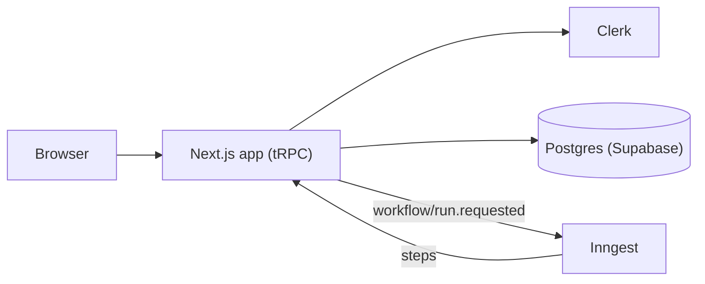

# Sovereign

Multi-tenant workflow automation with human approval gates, role-based access, an audit log, quotas, and database-level tenant isolation (Postgres row level security). A portfolio project built on free tiers.

- Live: https://sovereign-saas-platform.vercel.app
- CI: [](https://github.com/rajendrabist07/sovereign/actions/workflows/ci.yml)

## What works

- Sign-in and organisations with Clerk; each organisation is a tenant.
- Roles VIEWER < MEMBER < ADMIN < OWNER, enforced on the server for every call.
- Workflow builder: HTTP request, wait, manual approval and AI agent steps.
- Durable runs on Inngest, with a run list and a step timeline.
- Approvals: a run pauses until an ADMIN decides; the decision is stored in the database.
- Monthly run quota (100 runs on the free plan), an audit log, and error messages that do not leak server details in production.
- Tenant isolation in Postgres: row level security is enabled and forced on every tenant table. The app connects as a restricted role that cannot bypass it.

## Not built yet

- The AI agent step has never called the real Groq API. It is tested only against a scripted fake model and a local stub server. Without `GROQ_API_KEY`, an agent step fails with a clear message.
- API keys (the table exists, there is no code), rate limiting, an audit log viewer, and a replay button for failed steps.
- The OWNER role is never assigned: Clerk `org:admin` maps to ADMIN, everything else to MEMBER.
- No outbox: a crash between committing a run and queueing its event can leave a run PENDING.
- Development and the live site share one database.

## Architecture



## Stack

Turborepo, pnpm, Node 24, Next.js 16, React 19, TypeScript (strict), tRPC 11, Prisma 7, Supabase Postgres, Clerk, Inngest, Vercel, GitHub Actions.

## Running it locally

1. `pnpm install`, then copy `.env.example` to `.env` at the repo root and fill it in. `apps/web/.env.local` and `packages/db/.env` are symlinks to it.
2. Apply migrations with `DIRECT_URL` pointing at an admin connection:
   `cd packages/db && pnpm exec prisma migrate deploy`
3. Create the restricted runtime role. Migrations do not create it (it is a cluster-level role), so this is a manual step. Run it after the migrations:

```sql
CREATE ROLE app_user LOGIN PASSWORD '<choose-a-strong-password>'
  NOSUPERUSER NOCREATEDB NOCREATEROLE NOBYPASSRLS;
GRANT USAGE ON SCHEMA public TO app_user;
GRANT SELECT, INSERT, UPDATE, DELETE ON TABLE
  api_keys, approvals, memberships, quotas, run_steps,
  tenants, users, workflow_runs, workflows TO app_user;
GRANT SELECT, INSERT ON TABLE audit_log TO app_user;
```

4. Point `RUNTIME_DATABASE_URL` at that role. The database connection verifies the server certificate when `DB_SSL_CA` is set, and production refuses to start without it.
5. Start the app and the Inngest dev server in two terminals:
   `pnpm dev` and `pnpm run dev:inngest`

## Testing

Test scripts live in `apps/web/scripts` and `packages/db/scripts`.

- Full chain (needs the dev stack and about 7 runs of quota), from the repo root: `pnpm run verify-stack verify`. One complete run: 18 scripts, 397 checks passed, 0 failed. An earlier run stopped on a Prisma `P2028` transaction-start timeout; it was not reproduced, and the cause is not established.
- Database-only subset, in `apps/web`: `pnpm run verify-fast` (345 checks passed in the last run).
- Permission model, in `packages/db`: `pnpm run verify-permissions` (31 checks). On the live database it passes. The role SQL above and the 8 migrations were also run on a throwaway local Postgres 17 with two seeded tenants, where all 31 checks passed. That was not run on Supabase from scratch.
- CI runs only the tests that need no database, plus typecheck, lint and build. The database tests are not run in CI.

## Known limits

Free-tier limits apply (Inngest executions, Supabase storage, Groq rate limits). The error masking for unexpected server errors is covered by unit tests but has not been triggered on the live site.

## License

TBD.
